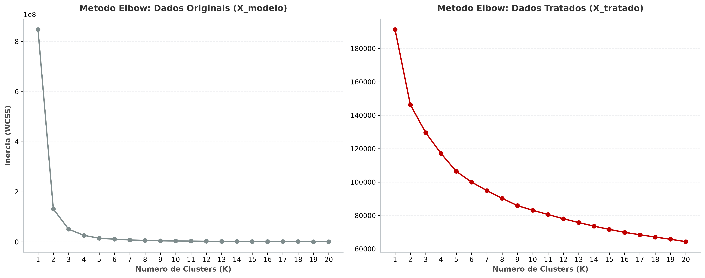

# 🗽 Airbnb NYC Market Segmentation
______________________________________
### (Clusterização Geoespacial e Topológica)
______________________________________

<p align="center">
  
  
  
  
  
  
</p>

---

## 📑 Sumário 

| Seção | Tópico |
| :---: | :--- |
| **1** | [🎯 Contexto de Negócio e Hipóteses ](#-1-contexto-de-negócio-e-hipóteses-validadas) |
| **2** | [⚙️ Arquitetura do Pipeline e Feature Engineering](#️-2-arquitetura-do-pipeline-e-feature-engineering) |
| **3** | [📐 Experimento A/B de Escalonamento no Espaço Euclidiano](#-3-experimento-ab-de-escalonamento-no-espaço-euclidiano) |
| **4** | [🔬 Jornada de Modelagem: Por que o K-Means e o DBSCAN Falham?](#-4-jornada-de-modelagem-por-que-o-k-means-e-o-dbscan-falham) |
| **5** | [🏆 Solução Campeã: HDBSCAN e Validação Topológica (UMAP)](#-5-solução-campeã-hdbscan-e-validação-topológica-umap) |
| **6** | [🗺️ Perfis Comerciais e Inteligência Geoespacial](#️-6-perfis-comerciais-e-inteligência-geoespacial) |
| **7** | [🗂️ Estrutura do Repositório e Reprodutibilidade (`configs.yaml`)](#️-7-estrutura-do-repositório-e-reprodutibilidade-configsyaml) |
| **8** | [🚀 Como Executar Localmente](#-8-como-executar-localmente) |

---

## 🎯 1. Contexto de Negócio e Hipóteses 

Este projeto desenvolve uma solução completa de **aprendizado não supervisionado** para segmentação estratégica dos anúncios do **Airbnb em Nova York** (`AB_NYC_2019.csv`), abrangendo **48.884 imóveis válidos** distribuídos nos **5 distritos (*boroughs*)** da cidade (**Manhattan, Brooklyn, Queens, Bronx e Staten Island**).

- Essa solução baseia-se no Dataset do Kaggle: <ahttps://www.kaggle.com/datasets/dgomonov/new-york-city-airbnb-open-data<a

Em vez de aplicar cortes arbitrários ou estratégias hardcodadas, o estudo investiga a **geometria intrínseca e a estrutura de densidade** do mercado para responder: `Quais são os verdadeiros perfis operacionais de locação em NYC e como eles se distribuem no espaço urbano?`

### 💡 Hipóteses de Negócio Avaliadas:

| # | Hipótese de Negócio | Variáveis-Chave | Impacto Estratégico & Ação Comercial | Status |
| :---: | :--- | :--- | :--- | :---: |
| **H1** | **Porte Operacional do Locador:** Anfitriões corporativos com múltiplos imóveis e calendário aberto o ano todo formam um ecossistema distinto de locadores casuais?. | `calculated_host_listings_count`, `availability_365`, `volume_oferta_dias_anfitriao` | Políticas comerciais B2B, gestão de contas-chave (*Key Accounts*) e fiscalização de *hosts* hoteleiros. | ✅ **Confirmada** *(Cluster 8 — Midtown)* |
| **H2** | **Vocação Regional e Tipologia:** Quartos privativos em distritos periféricos operam sob lógica de giro rápido e baixo ticket, divergindo dos imóveis inteiros de alto padrão no centro turístico?| `room_type`, `neighbourhood_group`, `price`, `custo_estadia`, `distancia_Times_Square` | Precificação dinâmica regionalizada (*Smart Pricing*) e campanhas de aquisição segmentadas por bairro. | ✅ **Confirmada** *(Clusters 0 a 7)* |
| **H3** | **Maturidade e Sazonalidade de Anúncios:** Imóveis consolidados com histórico denso de avaliações separam-se de anúncios recém-lançados ou sazonais de baixa disponibilidade ? | `number_of_reviews`, `reviews_per_month`, `meses_ativo`, `availability_365` | Réguas de retenção, ativação de *hosts* recém-cadastrados e auditoria de anúncios inativos/anômalos. | ✅ **Confirmada** *(Clusters 1, 5, 6 vs. -1)* |

---

## ⚙️ 2. Arquitetura do Pipeline e Feature Engineering

A base original possui **48.895 registros × 16 colunas**. Após o filtro de sanidade (`price > 0`, removendo 11 registros com preço zerado/inválido), restam **48.884 anúncios**.

### 📉 2.1. Tratamento de Caudas Longas (Transformação Log-Normal)

Variáveis financeiras e de contagem em plataformas digitais seguem distribuições de **cauda pesada (*Pareto / Log-Normal*)**. A variável `price` original exibia **assimetria extrema de `19,12`** e **curtose de `585,67`** (diárias de até US$ 10.000), o que inviabilizaria qualquer métrica baseada em distância euclidiana.


| Variável | Assimetria Bruta (*Skewness*) | Curtose Bruta (*Kurtosis*) | Transformação Aplicada | Justificativa Técnica |
| :--- | :---: | :---: | :---: | :--- |
| 💰 `price` | `19,12` | `585,67` | `np.log1p` $\rightarrow$ `price_log` | Reduz assimetria para **`0,63`**, curtose para **`1,34`** e outliers IQR de `6,08%` para **`1,28%`**. |
| 🌙 `minimum_nights` | `21,83` | `854,07` | `np.log1p` + compõe `custo_estadia_log` | Comprime exigências extremas de locação anual (365+ noites). |
| ⭐ `number_of_reviews` | `3,69` | `19,53` | `np.log1p` + compõe `meses_ativo_log` | Estabiliza a contagem acumulada entre anúncios novos e veteranos. |
| 🔄 `reviews_per_month` | `3,30` | `42,50` | `fillna(0)` + `np.log1p` | Os `10.052` nulos equivalem exatamente a imóveis com `0` avaliações. |
| 🏢 `calculated_host_listings_count` | `7,93` | `67,55` | `np.log1p` + compõe `volume_oferta_dias_anfitriao_log` | Comprime portfólios de megagestores (até 327 imóveis por *host*). |
| 📅 `availability_365` | `0,76` | `-1,00` | **Mantida em escala natural** | Limitada naturalmente a `[0, 365]` com baixa assimetria. |

---

### 🧪 2.2. Features Criadas para obter maior poder preditivo

Para capturar **efeitos de interação comercial** que variáveis isoladas não revelam, foram criadas **4 features derivadas**:

| Feature Criada | Fórmula Matemática | Significado Executivo |
| :--- | :--- | :--- |
| 📍 `distancia_Times_Square_log` | $\ln\left(1 + 2R \arcsin\sqrt{\sin^2\left(\frac{\Delta\phi}{2}\right) + \cos\phi_1\cos\phi_2\sin^2\left(\frac{\Delta\lambda}{2}\right)}\right)$ | **Distância Geodésica de Haversine** ($R = 6.371\text{ km}$) até a **Times Square** (`40.7580, -73.9855`). Corrige a curvatura terrestre e mede a centralidade turística real. |
| 💵 `custo_estadia_log` | $\ln(1 + \text{price} \times \text{minimum nights})$ | **Barreira de Entrada (Ticket Mínimo):** diferencia uma diária alta de 1 noite de uma diária moderada que exige 30 noites mínimas. |
| 📦 `volume_oferta_dias_anfitriao_log` | $\ln(1 + \text{availability 365} \times \text{host listings count})$ | **Capacidade Operacional do Anfitrião:** quantifica o estoque anual de *dias-imóvel* ofertados pelo locador na plataforma. |
| ⏳ `meses_ativo_log` | $\ln\left(1 + \frac{\text{number of reviews}}{\text{reviews per month} + 10^{-6}}\right)$ | **Maturidade do Anúncio:** estima há quantos meses o imóvel opera ativamente (retorna `0` para imóveis sem avaliações). |

---

### 🧹 2.3. Enconding, Análise Estatística e Seleção Final


1. **Codificação Categórica:**
   * **`room_type` (Ordinal Encoding):** `"Shared room": 0`, `"Private room": 1`, `"Entire home/apt": 2` — preserva a hierarquia natural de privacidade e área exclusiva sem inflar a dimensionalidade.
   * **`neighbourhood_group` (One-Hot Encoding com `drop_first=True`):** gera 4 variáveis binárias (`Brooklyn`, `Manhattan`, `Queens`, `Staten Island`), mantendo **`Bronx`** como categoria base implícita (`0` nas 4 dummies) para evitar multicolinearidade perfeita.
2. **Remoção de Variáveis Colineares (`collinearity_threshold = 0.70`):**
   * Como não há variável *target* (aprendizado não supervisionado), priorizou-se **manter as features compostas engenheiradas** (maior densidade informacional) e descartar as variáveis primárias redundantes: `minimum_nights_log` ($r = 0,82$ com `custo_estadia_log`), `calculated_host_listings_count_log` ($r \ge 0,70$ com `volume_oferta_dias_anfitriao_log`) e `number_of_reviews_log` ($r = 0,90$ com `meses_ativo_log`).
3. **Estrutura Final do `master.csv` (14 Colunas):**
   * **2 Coordenadas (`X_geo`):** `latitude`, `longitude` (isoladas da matriz de treino para evitar cortes espaciais redundantes e usadas exclusivamente nos mapas).
   * **12 Features de Modelagem (`X_modelo`):** **7 numéricas contínuas** + **1 ordinal** (`room_type`) + **4 dummies de distrito**.

---

## 📐 3. Experimento A/B de Escalonamento no Espaço Euclidiano

- Pergunta natural: O Escalonamento faz diferença nas features? Diante disso, fizemos um teste A/B.

Para evitar deformar as variáveis binárias (`0/1`) e ordinais, o pré-processamento aplica:
1. **Clipping nos quantis `1%` (`0.01`) e `99%` (`0.99`)** exclusivamente sobre as **7 variáveis numéricas contínuas**.
2. **`ColumnTransformer` com `RobustScaler`** (mediana e IQR) apenas nas **7 numéricas contínuas**, mantendo `room_type` e as 4 dummies de distrito intactas via `passthrough`.

Sorteando **10 pares de anúncios reais** (`random_state = 10`) e decompondo a contribuição quadrática média $(x_j - y_j)^2$ de cada atributo na distância Euclidiana total, comprovamos matematicamente a necessidade do escalonamento seletivo:

| Atributo (`X_modelo` vs. `X_tratado`) | Contribuição Quadrática Média **Sem Escala** | % da Distância Sem Escala | Contribuição Quadrática Média **Com `RobustScaler`** | Papel no Espaço Vetorial Pós-Escalonamento |
| :--- | :---: | :---: | :---: | :--- |
| 📅 `availability_365` | **`38.918,10`** | **99,98%** | `0,6720` | Deixa de monopolizar a distância; entra em equilíbrio com as demais. |
| ⏳ `meses_ativo_log` | `2,9533` | `< 0,01%` | **`1,1504`** | Passa a diferenciar anúncios maduros de recém-criados. |
| 💵 `custo_estadia_log` | `0,9637` | `< 0,01%` | **`1,0049`** | Reflete o peso real do ticket mínimo da reserva. |
| 💰 `price_log` | `0,5021` | `< 0,01%` | **`0,8606`** | Captura a faixa de preço por noite sem ser engolida pela disponibilidade. |
| 📦 `volume_oferta_dias_anfitriao_log` | `4,2973` | `0,01%` | **`0,8296`** | Separa anfitriões casuais de operadores de múltiplos imóveis. |
| 📍 `distancia_Times_Square_log` | `0,2618` | `< 0,01%` | **`0,7154`** | Preserva o gradiente contínuo centro-periferia. |
| 🏘️ Dummies de Distrito & `room_type` | `0,20` a `0,50` | `< 0,01%` | `0,20` a `0,50` | Mantidas em `[0, 1]` e `[0, 2]` via `passthrough`, sem distorção. |
| **Distância Euclidiana Média ($\pm\sigma$)** | **`163,09 ± 111,01`** | **100%** | **`2,85 ± 0,94`** | **Redução de 4 ordens de grandeza na variância bruta.** |

---

## 🔬 4. Modelage: Por que o K-Means e o DBSCAN Falham?

### 4.1. Baseline Particional: K-Means ($K=8$)

Na comparação da curva de inércia (*Método Elbow*), o tratamento com *Clipping* + `RobustScaler` reduz a inércia da casa de $10^8$ para $10^5$ e elimina a instabilidade entre $K=1$ e $K=3$:

<p align="center">
  
</p>

Avaliando as métricas internas de validação geométrica no intervalo $K \in [2, 10]$, selecionamos **$K=8$** como melhor ponto de inflexão (`Inertia = 90.314,31`, `Silhouette = 0,17`, `Davies-Bouldin = 1,74`, `Calinski-Harabasz = 7.811,04`):


#### 📊 Distribuição de Volume por Cluster no K-Means ($K=8$)

À primeira vista, o gráfico de barras de volume do K-Means sugere uma partição "bem comportada", dividindo os 48.884 anúncios em **8 blocos de tamanho similar** (variando entre `4.696` e `8.477` imóveis por grupo):


#### ❌ Por que o K-Means NÃO Funciona neste Problema? (Diagnóstico Topológico PCA & UMAP)

Essa uniformidade de tamanho do K-Means é, na realidade, um **Problema Estrutural**. Quando projetamos os 8 clusters do K-Means no espaço linear (**PCA**, que retém `50,83%` da variância em 2D) e no espaço topológico não-linear (**UMAP**), a falha estrutural fica evidente:

- Análise **PCA (Linear)**


- Análise **UMAP (Não Linear)**


> [!WARNING]
> **Diagnóstico das 3 Falhas Críticas do K-Means ($K=8$):**
> 1. **Fatiamento Artificial de Ilhas Naturais (Visível no UMAP acima):** O UMAP revela que os anúncios de NYC formam **ilhas não-lineares bem definidas**. Como o K-Means minimiza a distância quadrática ao centroide ($\|x - \mu_k\|^2$), ele impõe **fronteiras hiperesféricas rígidas** que cortam a mesma ilha ao meio (ex.: a grande ilha inferior esquerda é partida entre os Clusters `1`, `3` e `4`; as ilhas à direita misturam `0`, `2`, `5`, `6` e `7`).
> 2. **Diluição Geográfica e Hibridismo Comercial:** Na tabela de composição distrital do K-Means, os **Clusters `2`, `5` e `6`** misturam de **44% a 62% de imóveis do Brooklyn com 12% a 32% do Queens e 13% a 23% de Manhattan**, impedindo estratégias regionais puras. Enquanto isso, Manhattan é fatiada em 3 clusters (`1`, `3` e `4`) apenas por faixas brutas de disponibilidade (`164`, `0` e `290` dias).
> 3. **Ausência de Filtro de Ruído e Absorção de Nichos:** Por ser obrigado a alocar 100% dos pontos, o K-Means joga **anomalias extremas** (estadias de 1 ano, imóveis superfaturados) dentro dos grupos normais, deformando os centroides, e **engole micro-segmentos estratégicos** (como o Bronx e os Mega-Gestores hoteleiros de Midtown), que desaparecem diluídos nos clusters majoritários.

---

### 4.2. DBSCAN: O Impasse da Densidade Fixa

Para superar a geometria esférica do K-Means e isolar outliers como ruído (`label = -1`), testamos o **DBSCAN** em uma grade de **20 combinações** (`eps` $\in \{0.3, 0.5, 0.8, 1.0, 1.2\} \times$ `min_samples` $\in \{15, 30, 50, 100\}$), calculando as métricas exclusivamente sobre os clusters válidos:


| Faixa de Raio (`eps`) | % de Ruído (`-1`) | Nº de Clusters | Comportamento Observado & Diagnóstico |
| :---: | :---: | :---: | :--- |
| **`eps = 0.3`** *(Curto)* | **73,5% a 96,3%** | `5` a `43` | **Falso Positivo:** O DB aparente de `0,69` avalia apenas `3,7%` da base (hiperdensa em Manhattan) e descarta até `96,3%` do negócio como ruído. |
| **`eps = 0.5`** *(Médio)* | **26,4% a 66,8%** | `14` a `52` | Fragmenta os bairros em dezenas de micro-ilhas; quando o ruído cai para `26,4%`, o Silhouette colapsa para **`0,037`**. |
| **`eps = 0.8 – 1.0`** *(Alto)* | `0,9%` a `16,1%` | `4` a `8` | **Efeito *Chaining*:** Pontes de pontos conectam distritos distintos, degradando o Davies-Bouldin para **`1,54 – 1,64+`**. |
| **`eps = 1.2`** *(Muito Alto)* | `0,1%` a `0,5%` | **`1`** | **Colapso Total:** Mais de **99,4% da cidade** funde-se em um único cluster gigante (`N_Clusters = 1`). |

> **Conclusão sobre o DBSCAN:** Um único raio global (`eps`) é matematicamente incapaz de separar simultaneamente a altíssima densidade de Manhattan/Brooklyn e as densidades moderadas/baixas do Queens, Bronx e Staten Island.

---

## 🏆 5. Solução Campeã: HDBSCAN e Validação Topológica (UMAP)

O **HDBSCAN (*Hierarchical Density-Based Spatial Clustering of Applications with Noise*)** resolve o impasse do DBSCAN ao abandonar o corte horizontal fixo (`eps`) e construir uma **árvore hierárquica condensada de densidade variável** baseada na estabilidade de *Excess of Mass*.

Avaliamos uma grade de **16 combinações** (`min_cluster_size` $\in \{50, 100, 200, 500\} \times$ `min_samples` $\in \{15, 30, 50, 70\}$):


### 🎯 Seleção dos Hiperparâmetros Ótimos (`configs.yaml`)

| Hiperparâmetro / Métrica | Valor Campeão | Justificativa Técnica e de Negócio |
| :--- | :---: | :--- |
| 🔧 `min_cluster_size` | **`50`** | Preserva micro-segmentos estratégicos legítimos (como **Cluster 0 [70 imóveis]** no Bronx e **Cluster 8 [108 imóveis]** de Mega-Gestores), que colapsariam em `min_cluster_size >= 200`. |
| 🔧 `min_samples` | **`50`** | Ponto de equilíbrio ótimo da grade: evita a fragmentação excessiva de `min_samples = 15/30` (que descartavam até `29,7%` de ruído em `18` clusters). |
| 📊 **Clusters Válidos Formados** | **`9` (`0` a `8`)** | **100% de pureza geográfica distrital** em todos os 9 grupos válidos, separando automaticamente tipologia (Imóvel Inteiro vs. Quarto) e porte operacional. |
| 🛡️ **Taxa de Ruído Isolado (`-1`)** | **`11,65%` (`5.696`)** | Retém **88,35% da base** (`43.188` anúncios) em clusters puros e isola cirurgicamente os outliers multivariados. |
| 📐 **Davies-Bouldin / Calinski-Harabasz** | **`1,74` / `4.128,89`** | Excelente compacidade e separação nas variedades de densidade, sem o viés esférico do K-Means. |

---

### 📊 Distribuição de Volume por Cluster e Ruído no HDBSCAN

Diferente das 8 barras artificialmente iguais do K-Means, a distribuição de volume do HDBSCAN reflete a **assimetria real do mercado imobiliário de Nova York** — destacando os 4 megaclusters consolidados de Manhattan e Brooklyn (`1`, `5`, `6`, `7`), o polo intermediário do Queens (`2`, `3`), os 3 nichos específicos (`0`, `4`, `8`) e a camada de ruído (`-1`):


---

### 🧬 Validação Topológica no UMAP 2D: K-Means vs. HDBSCAN

Projetando os rótulos do HDBSCAN sobre a **mesma variedade topológica 2D do UMAP**, comprova-se o salto qualitativo: **cada ilha conexa de densidade recebe um cluster íntegro**, sem cortes artificiais ao meio, enquanto o ruído (`-1`, em cinza claro) envolve apenas as bordas difusas:


---

## 🗺️ 6. Perfis Comerciais e Inteligência Geoespacial

Os **9 clusters válidos** do HDBSCAN (`0` a `8`) + **Ruído (`-1`)** foram perfilados na escala original das variáveis (`X_analise` revertido via `np.expm1`) e consolidados em **5 Personas Comerciais Acionáveis + 1 Grupo de Ruído Estruturado**:

| Perfil Comercial (`profiles_mapping`) | Clusters HDBSCAN | Distrito (Pureza) | Diária Mediana (US$) | Ticket Estadia (US$) | Disponibilidade Anual (Mediana) | Oferta do Host (Dias·Imóvel) | Giro Mensal (Reviews/Mês) | Maturidade (Meses Ativos) | Tipologia Dominante (Moda) | Volume (% da Base) |
| :--- | :---: | :---: | :---: | :---: | :---: | :---: | :---: | :---: | :---: | :---: |
| 🏡 **1. Tradicional Brooklyn** | `5`, `6` | **Brooklyn (100%)** | `$145` (`5`) / `$63` (`6`) | `$435` / `$150` | `21` a `24` dias | `28` a `31` | `0,44` a `0,48` | `14,0` a `21,4` m | Inteiro (`5`) / Quarto (`6`) | **19.092 (`39,05%`)** |
| 🗽 **2. Turístico Manhattan** | `1`, `7` | **Manhattan (100%)** | `$190` (`1`) / `$85` (`7`) | `$675` / `$180` | `36` (`1`) / `5` (`7`) dias | `40` / `6` | `0,33` a `0,53` | `14,2` a `20,0` m | Inteiro (`1`) / Quarto (`7`) | **19.057 (`38,98%`)** |
| ✈️ **3. Econômico Queens** | `2`, `3` | **Queens (100%)** | `$115` (`2`) / `$58` (`3`) | `$279,5` / `$100` | `96` (`2`) / `65` (`3`) dias | `188` / `83` | `0,80` a `1,17` | `11,0` a `12,1` m | Inteiro (`2`) / Quarto (`3`) | **4.522 (`9,25%`)** |
| 🚇 **4. Periferia Ativa Bronx** | `0`, `4` | **Bronx (100%)** | `$99` (`0`) / `$50` (`4`) | `$200` / `$98` | `166` (`0`) / `136` (`4`) dias | `264` / `169` | **`1,20` a `2,94`** | `9,3` a `9,7` m | Inteiro (`0`) / Quarto (`4`) | **409 (`0,83%`)** |
| 🏢 **5. Mega-Gestores (Centro)** | `8` | **Manhattan (100%)** | `$100` | `$100` *(1 noite)* | **`333` dias** | **`2.965,5`** | `0,00` | `0,0` m | Quarto / Flat (`8`) | **108 (`0,22%`)** |
| 🛡️ **6. Ruído Estruturado** | `-1` | Misto (5 distritos) | `$99` | `$350` | `176` dias | `273,5` | `0,30` | `6,3` m | Misto / Outliers | **5.696 (`11,65%`)** |

---

### 🎻 Distribuição das 3 Principais Dimensões por Perfil Comercial

O gráfico de violino abaixo compara os **5 Perfis Comerciais** (excluindo o ruído) nas 3 dimensões operacionais mais discriminantes: **Capacidade de Oferta do Host (`volume_oferta_dias_anfitriao`)**, **Ticket Total da Estadia (`custo_estadia`)** e **Distância até a Times Square (`distancia_Times_Square`)**:


---

### 🗺️ Mapeamento Geoespacial em Nova York (GeoPandas + CartoDB Voyager)

Abaixo, visualizamos tanto a distribuição detalhada dos **9 clusters de densidade** quanto o mapa executivo consolidado nos **5 Perfis Comerciais**:

- 9 Clusters:


- 5 Perfis comerciais:


### 🔍 Interpretação Executiva das 5 Personas + Ruído

* 🏡 **1. Tradicional Brooklyn (Clusters `5` e `6` — `39,05%` da base | `19.092` anúncios):**
  * **Comportamento:** É o maior ecossistema da plataforma, situado a `~8,6 km` da Times Square. Divide-se perfeitamente entre **Imóveis Inteiros (`Cluster 5`, diária mediana US$ 145, ticket US$ 435)** e **Quartos Privativos (`Cluster 6`, diária US$ 63, ticket US$ 150)**.
  * **Vocação:** Anfitriões pessoa física (*moradores locais*) com **baixíssima disponibilidade anual (`21 a 24 dias/ano`)** e alta maturidade (`14 a 21 meses ativos`), que alugam seu imóvel apenas nas férias ou feriados. Representa a essência original do *home sharing*.
* 🗽 **2. Turístico Manhattan (Clusters `1` e `7` — `38,98%` da base | `19.057` anúncios):**
  * **Comportamento:** Concentrado no coração turístico (`3,25 a 4,82 km` da Times Square). O **`Cluster 1` (`12.720` imóveis)** é o maior cluster individual de NYC, com a **maior diária (US$ 190)** e o **maior ticket mínimo (US$ 675)**. O **`Cluster 7` (`6.337` imóveis)** reúne quartos privativos a US$ 85/noite com disponibilidade mediana de apenas `5 dias/ano`.
  * **Vocação:** Mercado hipervalorizado sob forte pressão regulatória municipal, operando com calendários restritos, altíssima demanda e ocupação plena.
* ✈️ **3. Econômico Queens (Clusters `2` e `3` — `9,25%` da base | `4.522` anúncios):**
  * **Comportamento:** Situado no eixo de conexão com os aeroportos **JFK e LaGuardia** (`7,75 a 8,93 km` da Times Square). Separa **Imóveis Inteiros (`Cluster 2`, US$ 115/noite)** de **Quartos Privativos (`Cluster 3`, US$ 58/noite)**.
  * **Vocação:** Turismo econômico e estadias de trânsito rápido. Mantém calendário aberto por mais tempo (`65 a 96 dias/ano`) e **alto giro mensal (`0,80 a 1,17 reviews/mês`)** para ganhar no volume.
* 🚇 **4. Periferia Ativa Bronx (Clusters `0` e `4` — `0,83%` da base | `409` anúncios):**
  * **Comportamento:** Localizado na maior distância da Times Square (`13,68 a 14,75 km`). Pratica os **preços mais acessíveis de NYC** (`US$ 50` no `Cluster 4` e `US$ 99` no `Cluster 0`), com disponibilidade elevada (`136 a 166 dias/ano`).
  * **Vocação:** Para compensar a distância do centro turístico, opera com preços ultra-agressivos e estadias curtas, conquistando a **maior velocidade de giro de toda a plataforma (`1,20 a 2,94 reviews/mês`)**.
* 🏢 **5. Mega-Gestores — Midtown Manhattan (Cluster `8` — `0,22%` da base | `108` anúncios):**
  * **Comportamento:** Cravado a apenas **`0,86 km` da Times Square** (`IQR = 0,68 km`). Apresenta disponibilidade quase integral (**`333 dias/ano`**), exigência de apenas **1 noite mínima** (ticket = diária = US$ 100) e um **volume de oferta explosivo de `2.965,5 dias-imóvel` (~100× o anfitrião residencial típico)**, com `0` avaliações acumuladas.
  * **Vocação:** Operadores 100% corporativos (redes de *apart-hotéis*, *hostels* e administradoras imobiliárias) que cadastram dezenas de unidades padronizadas no centro comercial.
* 🛡️ **6. Ruído Estruturado (Cluster `-1` — `11,65%` da base | `5.696` anúncios):**
  * **Comportamento:** Pulverizado pelos 5 distritos (`43,8%` Manhattan, `20,1%` Queens, `17,6%` Brooklyn, `12,0%` Bronx e `6,5%` Staten Island), com ticket mediano elevado (`US$ 350`) e alta disponibilidade (`176 dias/ano`).
  * **Vocação:** Isola imóveis com combinações anômalas (mansões de luxo, locações corporativas de longo prazo ou anúncios recém-criados fora do padrão regional), protegendo a pureza estatística dos 5 perfis comerciais.

---

Aqui está a markdown corrigida — removi o `.env.example` e ajustei a descrição do `config.py`:

---

## 🗂️ 7. Estrutura do Repositório e Reprodutibilidade (`configs.yaml`)

Todo o projeto foi refatorado para eliminar constantes *hardcoded*: diretórios, listas de colunas, limites de *clipping*, coordenadas geográficas, grades de hiperparâmetros e mapeamento de perfis residem no arquivo [`configs.yaml`](configs.yaml), carregado de forma centralizada por [`src/config.py`](src/config.py).

```text
Projeto-07/
├── data/
│   ├── raw/AB_NYC_2019.csv              # Base original bruta (48.895 linhas × 16 colunas)
│   └── processed/master.csv             # Base engenheirada (48.884 linhas × 14 colunas)
├── notebooks/
│   ├── 01_EDA.ipynb                     # EDA, testes de hipóteses, log1p, Haversine e multicolinearidade
│   └── 02_Modeling.ipynb                # Escalonamento, K-Means, DBSCAN, HDBSCAN, PCA/UMAP e Mapas
├── src/
│   ├── __init__.py                      # Exportação do pacote src
│   ├── config.py                        # Carregador centralizado do configs.yaml (fonte única da verdade)
│   ├── preprocessing.py                 # Limpeza, encoding, Haversine, clipping (1%-99%) e RobustScaler
│   ├── modeling.py                      # K-Means, grades DBSCAN/HDBSCAN (sem ruído nas métricas), PCA/UMAP
│   ├── profiling.py                     # Perfilamento em escala real e reconstrução da categoria base (Bronx)
│   └── plot_figs.py                     # Funções gráficas padronizadas (Matplotlib, Seaborn, Plotly, GeoPandas)
├── scripts/
│   ├── train.py                         # Treinamento reprodutível e serialização dos pipelines (.joblib)
│   ├── segment.py                       # Script de inferência para classificar novos CSVs nos perfis
│   └── dbscan_experiments.py            # Benchmark comparativo de densidade (DBSCAN vs. HDBSCAN)
├── artifacts/
│   └── modelo_hdbscan.joblib            # Pacote serializado (modelo + scaler + limites de clipping + colunas)
├── reports/
│   ├── figures/                         # Gráficos estáticos de alta resolução exportados (.png)
│   └── metrics/                         # Tabelas de métricas (K-Means, DBSCAN, HDBSCAN) e IDs segmentados
├── configs.yaml                         # Fonte única da verdade (parâmetros de dados, features e modelos)
├── main.py                              # Orquestrador ponta a ponta via linha de comando
├── requirements.txt                     # Dependências do ambiente Python
└── README.md                            # Documentação executiva e técnica do projeto
```

> O URL dos tiles do CartoDB (incluindo a chave de acesso aos mapas base) está centralizado em `configs.yaml` sob `visualization.carto_tiles_url`. **Não é necessário arquivo `.env`** — a chave é um token público de serviço de tiles, necessário para qualquer pessoa visualizar os mapas base do projeto.

---

## 🚀 8. Como Executar Localmente

### 1️⃣ Clone o repositório e configure o ambiente virtual

```bash
git clone https://github.com/caua-barreto/Airbnb_NYC_Segmentation.git
cd Airbnb_NYC_Segmentation

python3 -m venv .venv
source .venv/bin/activate  # Linux / macOS
# .venv\Scripts\activate   # Windows

pip install -r requirements.txt
```

### 2️⃣ Execute via Orquestrador / Scripts CLI

```bash
# 1. Pipeline completo (Pré-processamento + K-Means + Experimento de Distâncias + Perfilamento)
python main.py

# 2. Treinamento completo (K-Means + HDBSCAN campeão) e salvamento em artifacts/modelo_hdbscan.joblib
python scripts/train.py

# 3. Benchmark comparativo de densidade (gera tabelas e gráficos DBSCAN vs. HDBSCAN)
python scripts/dbscan_experiments.py

# 4. Inferência e atribuição de Perfil Comercial em novos anúncios
python scripts/segment.py data/raw/AB_NYC_2019.csv
```

### 3️⃣ Ou explore os Notebooks Interativos

1. **`notebooks/01_EDA.ipynb`** — Análise exploratória completa, tratamento de assimetria (`log1p`), engenharia de features geodésicas/operacionais, remoção de colinearidade e geração do `data/processed/master.csv`.
2. **`notebooks/02_Modeling.ipynb`** — Experimento controlado de distância Euclidiana, modelagem K-Means ($K=8$), diagnóstico topológico PCA/UMAP, comparativo DBSCAN vs. HDBSCAN, gráficos de violino e mapas geoespaciais de NYC.

---


## 🛠️ Tecnologias Utilizadas

| Categoria | Ferramentas & Bibliotecas |
| :--- | :--- |
| **Linguagem & Configuração** | `Python 3.12`, `PyYAML`, `python-dotenv`, `Joblib` |
| **Manipulação & Estatística** | `Pandas`, `NumPy`, `SciPy` |
| **Machine Learning & Clustering** | `Scikit-Learn` (`KMeans`, `DBSCAN`, `RobustScaler`, `ColumnTransformer`), `hdbscan` |
| **Redução de Dimensionalidade** | `Scikit-Learn` (`PCA`), `umap-learn` (`UMAP`) |
| **Visualização & Geoprocessamento** | `Matplotlib`, `Seaborn`, `Plotly`, `GeoPandas`, `Shapely`, `Contextily` (`CartoDB Voyager`) |

---

<p align="center">
  Desenvolvido por <a href="https://github.com/caua-barreto"><b>Cauã Barreto</b></a> 
  • Junior Data Scientist
</p>
