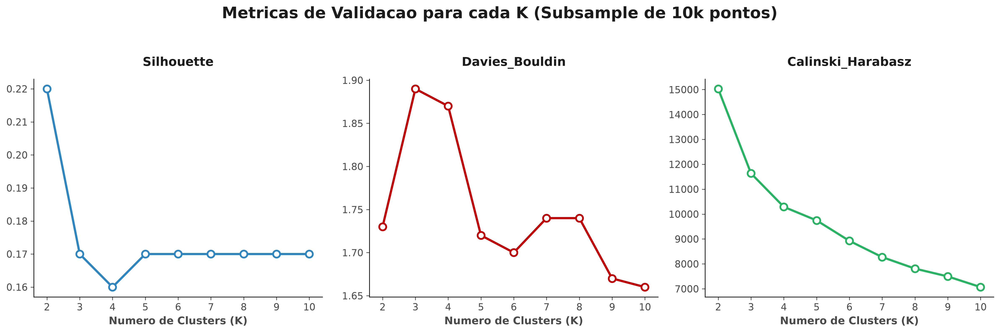
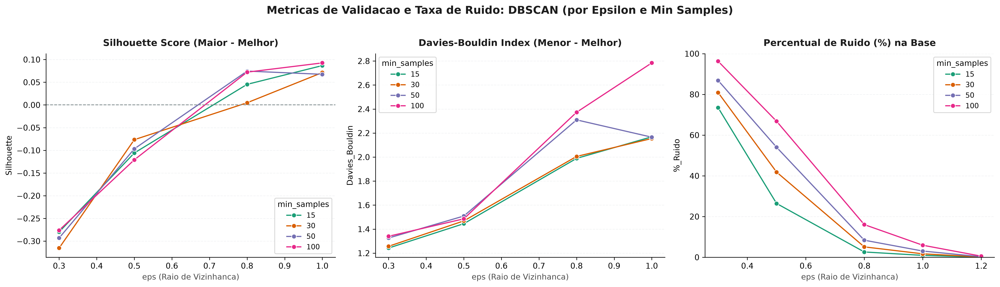
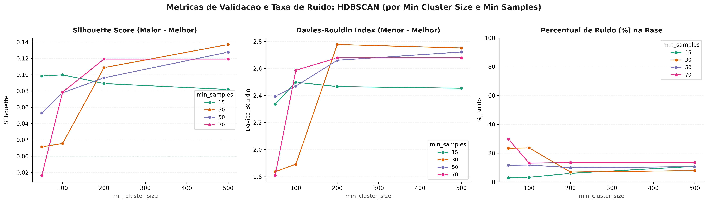
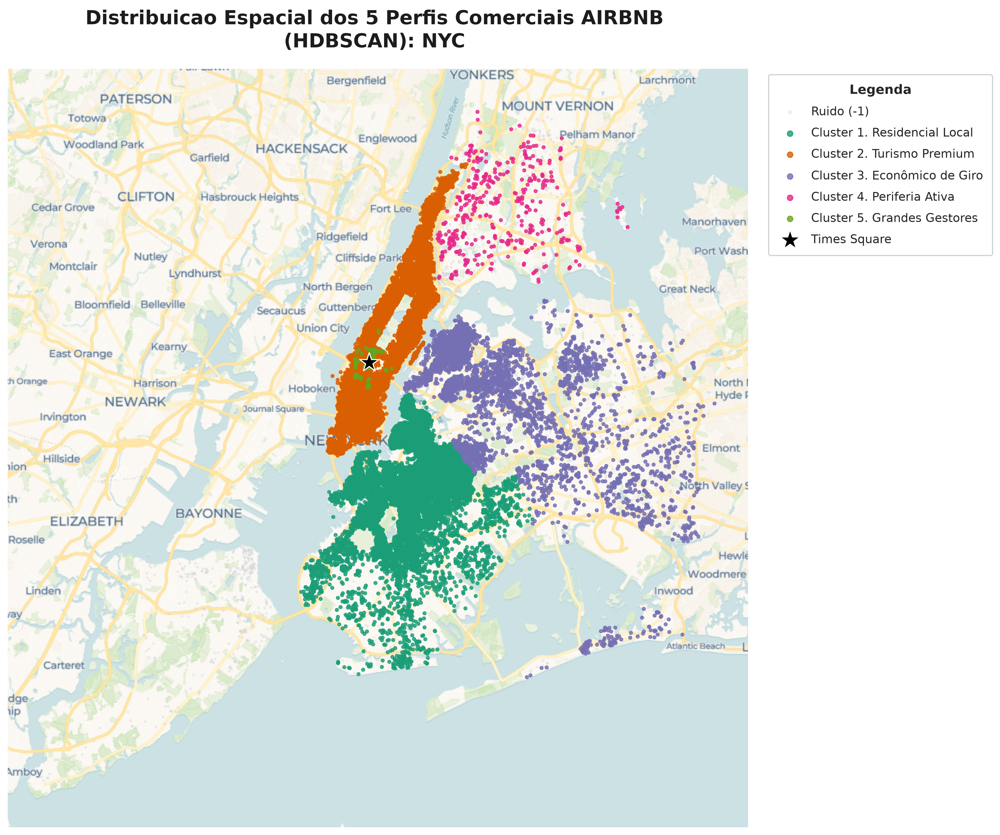
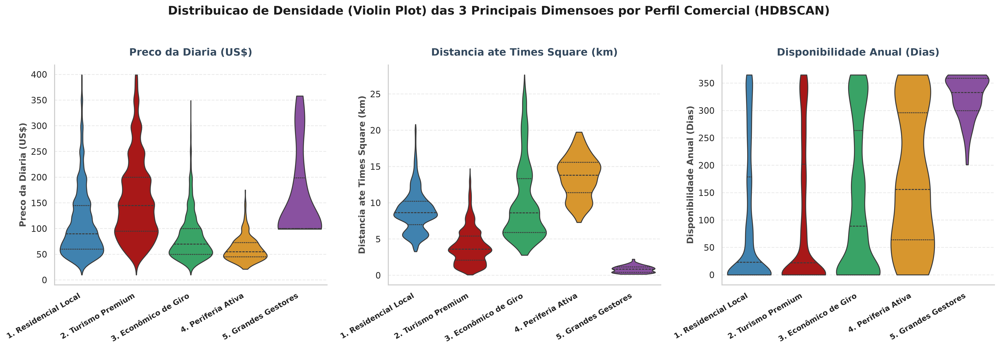

# 🗽 Airbnb NYC Market Segmentation — Clusterização Topológica e Geoespacial 


---

## Sobre o Projeto

Este repositório apresenta um projeto de **clusterização não supervisionada** para segmentação de mercado do Airbnb em Nova York, utilizando o dataset **AB_NYC_2019.csv** com **~48.884 registros válidos** de anúncios nas **5 regiões** da cidade (Manhattan, Brooklyn, Queens, Bronx e Staten Island).

O objetivo é **descobrir segmentos comerciais latentes** sem uma variável-alvo predefinida, com foco em:

- Pipeline robusta de pré-processamento com transformação **Log-Normal** e **RobustScaler**
- Comparação controlada entre **K-Means (particional esférico)**, **DBSCAN** e **HDBSCAN** (densidade)
- **Experimento A/B de distâncias** para demonstrar o impacto do escalonamento no espaço Euclidiano
- Diagnóstico topológico com **PCA** e **UMAP** para validar geometria dos clusters
- **Perfilamento comercial executivo** com 5 personas de negócio e mapeamento geoespacial (GeoPandas + CartoDB)
- Reprodutibilidade total via **configs.yaml**, scripts (`train.py`, `segment.py`) e módulos `src/`

### Hipóteses de Negócio Validadas

Três hipóteses de segmentação — centradas no **tipo de locador** e **vocação regional** — orientaram a engenharia de features e a interpretação dos perfis:

| # | Hipótese | Features Representativas | Utilidade Comercial |
|:---:|:---|:---|:---|
| 1 | **Porte do Locador** — Megagestores com portfolios massivos formam segmento distinto de anfitriões casuais de imóvel único | `calculated_host_listings_count`, `availability_365`, `price` | Políticas de parceria e priorização de suporte |
| 2 | **Vocação Regional** — Quartos econômicos na periferia (Queens, Bronx) apresentam perfil diferente de imóveis inteiros premium em Manhattan | `room_type`, `neighbourhood_group`, `price`, `minimum_nights` | Estratégias de comunicação e precificação por região |
| 3 | **Maturidade/Sazonalidade** — Anúncios com alta disponibilidade e muitas avaliações (maduros) diferem de anúncios recém-criados ou inativos | `availability_365`, `number_of_reviews`, `reviews_per_month`, `meses_ativos` | Ações de retenção e reativação de anúncios |

### Como o Modelo Funciona

1. **Pré-processamento:** Filtro de preços zerados, imputação de nulos, transformação `log1p` em variáveis de cauda longa, encoding (Ordinal + One-Hot), cálculo de features derivadas (distância Haversine, custo de estadia, volume de oferta, meses ativos)
2. **Escalonamento:** `ColumnTransformer` com `RobustScaler` exclusivamente nas 7 variáveis contínuas — dummies e ordinais passam intactas (`passthrough`)
3. **Redução de Dimensionalidade:** PCA (50.83% de variância em 2D) e UMAP (projeção não-linear)
4. **Clusterização:** K-Means (K=8) como baseline particional → DBSCAN rejeitado por densidade heterogênea → **HDBSCAN** (`min_cluster_size=50`, `min_samples=50`) como solução campeã baseada em densidade variável
5. **Perfilamento:** 9 clusters de densidade pura consolidados em **5 personas comerciais + ruído estruturado** (11.65% da base)

<p align="center">
  
</p>

> O **RobustScaler** reduz a inércia de 10^8 para 10^5 e elimina a anomalia visual entre K=1 e K=3. O ponto de inflexão em K=8 orienta a decisão, mas a validação topológica (UMAP) revela que cortes esféricos não respeitam a geometria real dos dados.

---

## Sobre o Dataset e Feature Engineering (O Diferencial)

O **AB_NYC_2019.csv** do Kaggle contém 16 colunas originais de anúncios:

| Tipo | Quantidade | Exemplos |
|------|-----------|----------|
| Numéricas | 10 | `price`, `minimum_nights`, `number_of_reviews`, `availability_365` |
| Categóricas Nominais | 4 | `neighbourhood_group` (5 regiões), `room_type` (3 tipos) |
| Identificadores/Texto | 5 | `id`, `host_id`, `name`, `host_name`, `neighbourhood` |
| Temporal | 1 | `last_review` (10.052 nulos — removida após gerar flag) |

### Transformação Logarítmica (Log-Normal)

A variável `price` apresentava **assimetria de 19.12** e **curtose de 585.67**, com 6.08% de outliers extremos (máximo de US$ 10.000). A transformação **`log1p`** resolveu ambos os problemas:

| Métrica | `price` (original) | `price_log` (log1p) |
|---------|:---:|:---:|
| Assimetria (Skewness) | 19.12 | **0.63** |
| Curtose (Kurtosis) | 585.67 | **1.34** |
| Outliers (IQR) | 6.08% | **1.28%** |

> A mesma transformação foi aplicada em `minimum_nights`, `number_of_reviews`, `reviews_per_month` e `calculated_host_listings_count`, reduzindo assimetrias que chegavam a 21.83 e 7.93 para patamares controlados abaixo de 3.28.

### Features Derivadas

| Feature | Cálculo | Interpretação de Negócio |
|:---|:---|:---|
| `distancia_Times_Square_km` | **Haversine** (lat, lon → km) | Proximidade do epicentro turístico de NYC — corrige a curvatura terrestre (não usa distância Euclidiana em graus) |
| `custo_estadia` | `price × minimum_nights` | Ticket total da estadia mínima exigida pelo anfitrião |
| `volume_oferta_dias_anfitriao` | `availability_365 × calculated_host_listings_count` | Porte operacional do anfitrião (dias disponíveis × nº de imóveis) |
| `meses_ativos` | `number_of_reviews / reviews_per_month` | Estimativa de maturidade do anúncio em meses — 0 para anúncios sem avaliação |

### Experimento Controlado de Escalonamento

<p align="center">
  
</p>

> **Cenário A (sem escala):** Distância Euclidiana média de **163.09**, dominada 99% pela variável `availability_365` (contribuição quadrática de ~38.918). As demais features — preço, reviews, distância geográfica — eram irrelevantes na distância total.
>
> **Cenário B (RobustScaler):** Distância cai para **2.85**, com equilíbrio entre as 7 features contínuas. `availability_365` deixa de monopolizar o espaço vetorial, e `custo_estadia_log`, `meses_ativo_log` e `price_log` passam a contribuir de forma comparável. As dummies de bairro e `room_type` permanecem intactas (passthrough) — sua contribuição não é artificialmente inflada nem suprimida.

---

## Jornada de Modelagem (O Core do Storytelling)

### 1. K-Means e o Colapso Topológico

O **K=8** foi selecionado via Elbow + Davies-Bouldin (mínimo de **1.74** entre K=2 e K=10), com clusters equilibrados (4.7k a 8.5k registros). Porém, ao projetar os rótulos no espaço **UMAP**, o diagnóstico é devastador:

<p align="center">
  
</p>

> O K-Means impõe **fronteiras esféricas (Voronoi)** que cortam as ilhas topológicas naturais ao meio. Clusters como 1, 3 e 4 concentram-se 94-99% em Manhattan, fatiando artificialmente o mesmo distrito apenas por faixas de disponibilidade. Nichos puros (Bronx, Staten Island, megagestores) são absorvidos pelos clusters majoritários.

### 2. DBSCAN e o Impasse da Densidade Fixa

O DBSCAN foi testado em **20 combinações** (5 valores de `eps` × 4 de `min_samples`). O resultado expõe a limitação estrutural do algoritmo para densidade heterogênea:

<p align="center">
  
</p>

> - **`eps = 0.3`:** O raio curto captura apenas o miolo hiperdenso de Manhattan, descartando **73.5% a 96.3%** da base como ruído.
> - **`eps = 0.8 a 1.0`:** O efeito *chaining* (encadeamento) funde bairros inteiros em super-clusters, degradando o Davies-Bouldin.
> - **`eps = 1.2`:** 100% da cidade colapsa em 1 único cluster.
>
> **Conclusão:** Um único raio global (`eps`) não pode operar simultaneamente na densidade de Manhattan, Brooklyn, Queens e Staten Island. O DBSCAN foi **descartado**.

### 3. HDBSCAN — A Solução Campeã

O HDBSCAN, por operar com **densidade variável** (cluster tree + condensed tree), resolve o impasse. A grade de **16 combinações** (4 `min_cluster_size` × 4 `min_samples`) revelou o ponto ótimo:

<p align="center">
  
</p>

| Hiperparâmetro | Valor Selecionado | Justificativa |
|:---|:---:|:---|
| `min_cluster_size` | **50** | Menor Davies-Bouldin da grade (2.01) — valores maiores fundem nichos estratégicos |
| `min_samples` | **50** | Equilíbrio entre pureza (11.65% de ruído) e retenção (88.35% da base) |
| `core_dist_n_jobs` | **-1** | Paralelização total — ~49k linhas processadas em todos os núcleos |

**Resultado final:** **9 clusters com 100% de pureza geográfica + 1 grupo de ruído estruturado (cluster -1)**.

<p align="center">
  
</p>

> O HDBSCAN isola cirurgicamente **11.65% da base como ruído** (5.696 anúncios com combinações atípicas de preço, estadia e localização) sem contaminar os perfis. Cada um dos 9 clusters válidos corresponde a **exatamente um distrito** de NYC — o algoritmo respeitou a topologia real sem fatiar ilhas de densidade.

---

## Perfis Comerciais e Inteligência Geoespacial

Os 9 clusters do HDBSCAN são consolidados em **5 personas de negócio + ruído**:

| Perfil Comercial | Clusters | Distrito | Preço Mediano | Disponibilidade | Volume (% Base) |
|:---|:---:|:---:|:---:|:---:|:---:|
| 🏡 **Tradicional do Brooklyn** | 5, 6 | Brooklyn (100%) | US$ 63 a US$ 145 | 21–24 dias/ano | **39.05%** |
| 🗽 **Turístico de Manhattan** | 1, 7 | Manhattan (100%) | US$ 85 a US$ 190 | 5–36 dias/ano | **38.98%** |
| ✈️ **Econômico do Queens** | 2, 3 | Queens (100%) | US$ 58 a US$ 115 | 65–96 dias/ano | **9.25%** |
| 🚇 **Periferia Ativa — Bronx** | 0, 4 | Bronx (100%) | US$ 50 a US$ 99 | 136–166 dias/ano | **0.83%** |
| 🏢 **Mega-Gestores — Midtown** | 8 | Manhattan (100%) | US$ 100 | 333 dias/ano | **0.22%** |
| 🛡️ **Ruído Estruturado** | -1 | Misto (5 distritos) | US$ 99 | 176 dias/ano | **11.65%** |

<p align="center">
  
</p>

### Detalhamento das Personas

**🏡 Tradicional do Brooklyn** — Maior volume da plataforma (39% da base). Anfitriões **pessoa física** que alugam a própria casa ou quarto extra apenas em períodos específicos (férias/alta temporada). Baixíssima disponibilidade (21-24 dias/ano) e alta maturidade (14-21 meses ativos). Este é o núcleo da **economia compartilhada** original do Airbnb.

**🗽 Turístico de Manhattan** — Imóveis de alto valor agregado sujeitos a fortes restrições regulatórias. O cluster 1 (maior cluster individual com 12.720 anúncios) opera com ticket de US$ 675 por estadia e disponibilidade restrita a 36 dias/ano — reflexo de ocupação quase plena ou preços premium em datas pontuais.

**✈️ Econômico do Queens** — Focado em turismo de custo-benefício próximo aos aeroportos JFK e LaGuardia. Alta rotatividade (0.80 a 1.17 reviews/mês) e maior disponibilidade anual (65-96 dias). Calendário aberto por mais tempo para gerar volume via preços agressivos (a partir de US$ 58/noite).

**🚇 Periferia Ativa — Bronx** — Compensa o afastamento geográfico (13.68 a 14.75 km da Times Square) mantendo imóveis disponíveis quase metade do ano a preços ultra-agressivos (US$ 50 a US$ 99). Apresenta o **maior giro de avaliações de toda a plataforma** (1.20 a 2.94 reviews/mês).

**🏢 Mega-Gestores — Midtown** — Apenas 108 anúncios a 0.86 km da Times Square. Operação **100% profissional**: calendário aberto 333 dias/ano, volume de oferta explosivo (2.965 dias-imóvel — ~100x o anfitrião típico) e ticket mínimo de 1 noite. Perfil de redes de apart-hotéis e gestoras imobiliárias.

**🛡️ Ruído Estruturado (-1)** — Isola 5.696 anúncios com combinações atípicas de preço, estadia mínima, maturidade e localização. **Não é descartado** — é tratado como categoria separada para auditoria de outliers, detecção de fraudes ou erros de cadastro.

---

## Estrutura do Repositório e Reprodutibilidade Total

```
Projeto-07/
├── data/
│   ├── raw/AB_NYC_2019.csv              # Dataset original (~48.9k linhas × 16 colunas)
│   └── processed/master.csv             # Base processada (48.884 linhas × 14 features)
├── notebooks/
│   ├── 01_EDA.ipynb                     # Análise exploratória, hipóteses, feature engineering
│   └── 02_Modeling.ipynb                # K-Means, DBSCAN, HDBSCAN, PCA/UMAP, perfilamento
├── src/
│   ├── preprocessing.py                 # Pipeline de limpeza, encoding, Haversine, log1p, ColumnTransformer
│   ├── modeling.py                      # Treinamento K-Means, grade DBSCAN/HDBSCAN, PCA, UMAP
│   ├── profiling.py                     # Perfilamento executivo e composição cruzada
│   └── plot_figs.py                     # Todas as funções de visualização (auto-save em reports/figures/)
├── scripts/
│   ├── train.py                         # Pipeline HDBSCAN completo + salvamento de artefatos
│   ├── segment.py                       # Inferência: carrega pipeline e classifica novos CSVs
│   └── dbscan_experiments.py            # Experimentos comparativos DBSCAN vs HDBSCAN
├── artifacts/
│   └── modelo_hdbscan.joblib            # Pipeline treinado (preprocessor + HDBSCAN)
├── reports/
│   ├── figures/                         # 6 figuras exportadas automaticamente (PNG + HTML)
│   └── metrics/                         # 4 CSVs com métricas e tabela ID × Cluster
├── configs.yaml                         # Configuração centralizada (features, parâmetros, coordenadas, tiles CartoDB)
├── main.py                              # Orquestrador: executa pipeline completo via terminal
├── requirements.txt                     # Dependências congeladas
└── README.md                            # Este documento
```

### Engenharia para Reprodutibilidade Total

O projeto foi projetado para rodar em **qualquer cidade do Airbnb** sem alterações no código-fonte. Toda a lógica de pré-processamento, modelagem e visualização é orientada por **configuração centralizada** (`configs.yaml`):

```yaml
# Exemplo de configuração para Paris (Torre Eiffel)
cidade: "Paris"
coordenadas_marco: { lat: 48.8584, lon: 2.2945 }
features_log: ["price", "minimum_nights", "number_of_reviews", ...]
kmeans_k: 8
hdbscan_min_cluster_size: 50
hdbscan_min_samples: 50
```

> **Para adaptar a uma nova cidade:** (1) coloque o CSV bruto em `data/raw/`, (2) altere as coordenadas do marco central e as colunas alvo no `configs.yaml`, (3) execute `python main.py`. O pipeline inteiro — limpeza, engenharia de features, modelos e gráficos — se ajusta automaticamente. O URL dos tiles do CartoDB (incluindo a chave de acesso aos mapas base) também está centralizado no `configs.yaml`.

---

## Como Executar Localmente

### (1) Clone este repositório:

```bash
git clone https://github.com/caua-barreto/Airbnb_NYC_Segmentation.git
cd Airbnb_NYC_Segmentation
```

### (2) Crie um ambiente virtual:

```bash
python -m venv .venv
source .venv/bin/activate  # Linux/macOS
# .venv\Scripts\activate   # Windows
```

### (3) Instale as dependências:

```bash
pip install -r requirements.txt
```

### (4) Execute os notebooks na ordem:

1. `notebooks/01_EDA.ipynb` — Análise Exploratória, limpeza e exportação do `master.csv`
2. `notebooks/02_Modeling.ipynb` — K-Means, DBSCAN, HDBSCAN, PCA/UMAP, perfilamento e exportação do pipeline

### (5) Ou use o orquestrador via terminal:

```bash
# Pipeline completo — processamento, treinamento, experimentos e perfilamento
python main.py

# Apenas treinamento HDBSCAN e salvamento de artefatos
python scripts/train.py

# Inferência em novos anúncios
python scripts/segment.py data/raw/novos_anuncios_nyc.csv
```

---

## Limitações e Próximos Passos

### Limitações

- **Dataset estático (2019):** A base reflete um snapshot pré-pandemia do mercado de locação de curta temporada. A distribuição espacial e os padrões de preço podem ter mudado significativamente desde então.
- **HDBSCAN não possui `predict()` nativo:** O scikit-learn não implementa `predict()` para DBSCAN/HDBSCAN. A inferência em novos dados para a solução campeã exigiria um classificador auxiliar (ex: NearestCentroid) treinado sobre os rótulos do HDBSCAN — implementado no `scripts/segment.py`.
- **Interpretação tautológica de `room_type` e `neighbourhood_group`:** Como essas variáveis foram incluídas como features na matriz de treinamento, a separação observada nos perfis faz parte da definição geométrica dos clusters e **não deve ser tratada como validação externa independente**.
- **`availability_365` não é taxa de ocupação:** A coluna mede a disponibilidade declarada para os próximos 365 dias, não as reservas efetivamente realizadas. Imóveis com `availability_365 = 0` podem estar totalmente ocupados ou simplesmente inativos.

### Próximos Passos

1. **Adicionar NLP na descrição dos anúncios** (`name`) para capturar amenities e características latentes do imóvel
2. **Incorporar sazonalidade temporal real** — a base de 2019 não contém séries temporais, mas datasets complementares do Airbnb (reviews ao longo do tempo) permitiriam analisar padrões sazonais de ocupação
3. **Implementar classificador transdutivo** (NearestCentroid ou RandomForest) treinado sobre os rótulos do HDBSCAN para classificar novos anúncios sem reexecutar o clustering de densidade
4. **Testar OPTICS** como alternativa ao HDBSCAN para validação da estrutura de densidade

---

## Tecnologias Utilizadas

| Biblioteca | Uso |
|------------|-----|
| **Python 3.12** | Linguagem base |
| **Pandas / NumPy** | Manipulação e transformação de dados |
| **Scikit-learn** | K-Means, DBSCAN, RobustScaler, ColumnTransformer, PCA, métricas internas |
| **HDBSCAN** | Clusterização hierárquica baseada em densidade |
| **UMAP-learn** | Redução de dimensionalidade não-linear |
| **Plotly** | Projeções 2D interativas (PCA e UMAP) |
| **Matplotlib / Seaborn** | Visualização estática e gráficos de violino |
| **GeoPandas / Contextily / Shapely** | Mapeamento geoespacial sobre tiles do CartoDB |
| **Joblib** | Serialização do pipeline treinado |
| **PyYAML / python-dotenv** | Configuração centralizada e proteção de credenciais |

---

*Desenvolvido por [Cauã Barreto](https://github.com/caua-barreto)*  
*Junior Data Scientist*
